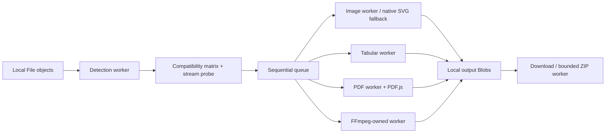

# OmniConvert

OmniConvert is a privacy-first browser conversion workbench for domain-valid file transformations. User file payloads are processed locally in the browser; the MVP does not require accounts, cloud storage, or a conversion backend.

## Status

The current candidate passes root check/build,82 unit tests,75 browser scenarios and release-artifact checks (2026-10-26). Entry JS/CSS is85,843 bytes gzipped against150,000. Corrective permanent CI is pending in [`TODO.md`](./TODO.md). Repository `AahPlexX/fc` stays on `main`; the portable launch/update/rollback procedure is [`docs/production.md`](./docs/production.md). No deployment has been performed.

The complete original user-supplied product brief is preserved verbatim in [`PRD.md`](./PRD.md). That file is an immutable baseline: verified corrections, package/version updates, implementation deltas, and architecture refinements are documented in this README, `TODO.md`, `CHANGELOG.md`, and ADRs without rewriting the original PRD.

The UI accepts files through the native multi-file picker, a keyboard-operable drop target, or clipboard paste. Imported bytes are inspected locally before a job is added. Binary formats are signature-detected; CSV/TSV/JSON are identified from structured UTF-8 content. Unsupported files are skipped rather than guessed from extensions or browser MIME values. Queue controls support per-file target selection/cancellation, batch target selection, batch metadata stripping policy, and aggregate progress for multiple active jobs.

Image conversion uses `createImageBitmap()` plus `OffscreenCanvas` inside a dedicated worker. Requested output MIME types are verified against the Blob returned by the browser so unsupported AVIF cannot silently succeed as PNG. Bitmaps are closed after every conversion attempt. Metadata inspection runs separately, receives raw bytes rather than paths/URLs, and initially exposes only normalized file, EXIF, GPS, and composite values.

Tabular conversion uses a canonical row/column model. Papa Parse is dynamically imported only for CSV/TSV parsing or serialization. CSV/TSV exports enable formula escaping, while Markdown and HTML outputs escape cell content before rendering.

PDF operations are split by responsibility: pdf-lib reads/updates document-info metadata and serializes bytes, while PDF.js renders pages. PDFs are always loaded from in-memory bytes. The PDF.js worker asset is bundled with the application and resolved same-origin; OmniConvert does not use a CDN fallback. Page numbers are validated as 1-based before rendering, rendered page dimensions are derived from PDF.js viewports, and page/document resources are cleaned up even when rendering fails.

Media transcoding is represented by one lazy `MediaAdapter` engine at a time. The adapter refuses non-same-origin FFmpeg core/WASM/class-worker URLs, writes inputs to FFmpeg's virtual filesystem, executes the requested command, reads binary output, and cleans temporary files. Progress is determinate only when a route explicitly marks FFmpeg progress as reliable; otherwise elapsed media time remains visible with indeterminate completion. Cancellation terminates the active FFmpeg worker, invalidates that engine, and forces a fresh engine/load before subsequent work.

## Verified foundation stack — 2026-10-23

- React 19.3.1 / React DOM 19.3.1
- TypeScript 7.0.2
- Vite 8.3.5 with `@vitejs/plugin-react` 6.1.2
- pnpm 12.15.0
- Vitest 5.0.5
- Playwright 1.64.1 and `@axe-core/playwright` 4.14.0
- FFmpeg.wasm: `@ffmpeg/ffmpeg` 0.12.15, `@ffmpeg/core` 0.12.10, `@ffmpeg/util` 0.12.2. The wrapper is MIT; the published core package declares GPL-2.0-or-later and must be handled accordingly when distributed.
- Papa Parse 5.7.0
- ExifReader 4.51.0
- pdf-lib 1.17.1 and PDF.js (`pdfjs-dist`) 6.4.299
- JSZip 3.10.2
- piexifjs 1.0.6 with `@types/piexifjs` 1.0.0
- Biome 2.6.2

All package versions are exact pins. Heavy conversion libraries remain lazy-loaded so they do not enter the initial application path.

## Architectural corrections to PRD v1.0.0

1. `@ffmpeg/ffmpeg` already runs transcoding through its own worker; no redundant parent media worker is added without measured need.
2. FFmpeg.wasm's `progress` event is experimental; determinate UI degrades to indeterminate/phase telemetry when reliability is unknown.
3. `pdf-lib` creates/edits PDF structure but is not a page renderer; PDF-to-image routes use PDF.js.
4. axe is an automated regression gate, not proof of complete WCAG 2.2 AA conformance.
5. `TODO.md` is the corrected <=3-new-files-per-phase implementation sequence.
6. PWA is not considered complete until manifest + service-worker/offline behavior are implemented and verified.

## Local development

Prerequisites: Node.js >=22.13.0 and pnpm 12.15.0.

```bash
pnpm install --frozen-lockfile
pnpm dev
pnpm check
pnpm test
pnpm build
pnpm release:check
```

## Privacy invariant

Conversion code must never transmit user-selected file contents. Network access is limited to same-origin application assets in production. Any future file egress requires a separately approved product change.

## Hosting note

Multi-threaded FFmpeg requires cross-origin isolation headers. The MVP defaults to the single-thread FFmpeg core so static hosts without COOP/COEP can still function; multi-threading may be capability-gated later.

## Integrated workbench (2026-10-25)
Choose compatible targets, convert one file or run the queue sequentially, cancel the active engine, inspect/edit supported metadata, preview completed output, download individually or export a ZIP. Retry cancelled/failed jobs with Convert. Matching-domain batch settings do not affect running/completed outputs. PDF page numbers are 1-based comma-separated; PDF-to-image exports one selected page (first by default). Compile / merge PDF combines queued images/PDFs in queue order.

Workers perform detection, metadata inspection, raster encoding, tables, PDF operations and ZIP packaging/extraction. FFmpeg runs in its own worker and is terminated after each conversion to release WASM memory; the existing MediaAdapter remains a separately tested reusable lifecycle contract. FFmpeg assets are copied from exact installed packages to same-origin versioned `/engines/core/<version>/` and `/engines/wrapper/<version>/` paths; no CDN fetches. Main-thread work is UI updates and asynchronous byte transfers. Text input and table UTF-8 output are capped at64MiB; tables allow250,000 rows,2,000 columns and2,000,000 canonical cells; individual files at 1.5 GB with a 500 MB warning. ZIP input/output expansion is bounded to 256 MiB / 1,000 entries / 100:1 ratio. ZIP64, encryption, nested archives, symlinks, traversal, and legacy non-UTF-8 names are rejected.

The production service worker precaches the shell and caches conversion assets only after use. A newly installed shell cannot convert a domain offline until that domain's assets have first loaded online. It never caches user files/results. Production `_headers` contains a CSP; hosts must honor those headers or configure the equivalent themselves. The default single-thread engine does not require cross-origin isolation. WASM core assets are distributed under their package license (GPL-2.0-or-later), separately from the MIT wrapper.

### Verification scope
`pnpm test` runs unit contracts only; browser tests run via `pnpm exec playwright test` after `pnpm build` and `pnpm exec playwright install chromium firefox webkit`. Lint targets source/tests/config rather than generated `dist` code. Current entry JS/CSS measured85,843 bytes gzipped (budget 150,000) in this continuation. Field CWV percentiles, current/previous stable browser coverage, complete manual WCAG evaluation and 99% confidence remain UNVERIFIED; automated axe and lab checks are narrower evidence.

## Supported routes
| Source | Output |
|---|---|
| PNG/JPEG/WebP/AVIF/BMP/ICO/static GIF/SVG | PNG, JPEG, WebP, BMP, ICO, PDF; AVIF when native encoder passes probe |
| WAV/MP3/FLAC/AAC and probed audio containers | WAV, MP3, FLAC, Ogg, AAC, M4A |
| Probed MP4/MOV/WebM/Matroska video | MP4, WebM, MOV, animated GIF; MP3/WAV/FLAC/AAC/Ogg audio extraction |
| CSV/TSV/JSON/Markdown tables | CSV, TSV, JSON, Markdown, safe standalone HTML |
| PDF | PDF metadata/page extraction; PNG/JPEG selected page; merge PDFs/images |
| Markdown/plain text | Safe standalone HTML, standard-font PDF; TXT normalization |
| ZIP | Guarded extraction into supported files; completed outputs packaged as ZIP |

Unsupported codec/browser encoder combinations fail with a per-item message. Raster dimensions/quality are configurable; ICO emits standard sizes. Non-JPEG source metadata is discarded on raster re-encoding; JPEG can retain EXIF when privacy mode is off. Explicit overrides are written after privacy stripping. PDF stripping covers Info/catalog XMP; it does not redact page content, annotations or attachments. Technical encoder/container fields may be generated in media output.



## Registry verification — 2026-10-25
All 22 pinned runtime/development packages and the package-manager entry below were queried by exact `name@version` against the npm registry using `pnpm view ... version license --json` (23 total including pnpm). This verifies availability and declared license, not latest-version status or security guarantees. Frozen installation also passed under the pinned pnpm 12.15.0; the workspace's initial fallback pnpm was 11.25.0.

| Package | Exact pin | Registry declared license |
|---|---|---|
| `@ffmpeg/core` | 0.12.10 | GPL-2.0-or-later |
| `@ffmpeg/ffmpeg` | 0.12.15 | MIT |
| `@ffmpeg/util` | 0.12.2 | MIT |
| `exifreader` | 4.51.0 | MPL-2.0 |
| `jszip` | 3.10.2 | (MIT OR GPL-3.0-or-later) |
| `papaparse` | 5.7.0 | MIT |
| `pdf-lib` | 1.17.1 | MIT |
| `pdfjs-dist` | 6.4.299 | Apache-2.0 |
| `piexifjs` | 1.0.6 | MIT |
| `react` | 19.3.1 | MIT |
| `react-dom` | 19.3.1 | MIT |
| `@axe-core/playwright` | 4.14.0 | MPL-2.0 |
| `@biomejs/biome` | 2.6.2 | MIT OR Apache-2.0 |
| `@playwright/test` | 1.64.1 | Apache-2.0 |
| `@types/papaparse` | 5.5.2 | MIT |
| `@types/piexifjs` | 1.0.0 | MIT |
| `@types/react` | 19.3.0 | MIT |
| `@types/react-dom` | 19.3.0 | MIT |
| `@vitejs/plugin-react` | 6.1.2 | MIT |
| `typescript` | 7.0.2 | Apache-2.0 |
| `vite` | 8.3.5 | MIT |
| `vitest` | 5.0.5 | MIT |
| `pnpm` | 12.15.0 | MIT |

### Concurrent integration
Concurrent upstream commits through 057f619 are merged, not overwritten. `exportManager` naming/native download functions are reused by the workbench; archive generation delegates to the bounded archive implementation. `ConversionOrchestrator` remains an exported compatibility API whose browser runtime delegates to the common `conversionRunner`, avoiding two diverging execution implementations.

## Verification continuation
[Verification evidence](docs/verification.md) records82 unit and the current75-scenario browser gate, reproducible lab measurements and unsupported signals. ZIP packing is cancellable and serialized with the active workspace operation; completed outputs survive cancellation and the prepared archive can be downloaded again. Metadata inspection displays loading/errors and closes cleanly. All media probes/transcodes share one abort-aware slot. Table input and output Blob encoding stay in the worker.

Service-worker cache names derive from build content including same-path FFmpeg assets; old caches are removed on activation. CI retains raw browser/measurement evidence for 14 days. `THIRD_PARTY_NOTICES.txt` ships in the build with core/wrapper license texts and pinned source pointers; the precise remaining redistribution audit is in LICENSES. Lab measurements and browser simulation do not establish manual/field conformance.

The continuation also closes the explicit PDF date-inspection and chunked-table requirements: CSV/TSV uses stateful UTF-8 decoding across 1MiB slices with real byte/row progress, preventing Unicode corruption at byte boundaries. PDF creation/modification dates are inspected read-only. The live worker protocol carries File input, progress events and final Blob output. The64MiB cap now applies to both input and UTF-8 output. Output is retained as bounded parts; shape limits precede canonical table expansion. Native JSON parsing and individual-row serialization still require transient memory.

## Production hardening — 2026-10-26
Table limits apply to Blob, string and legacy worker paths; prototype-like column names retain their values and missing own properties become null. ZIP input travels as File to its worker and is rejected above256MiB before a full read. Previews now handle Markdown→PDF and PDF→image correctly, including loaded empty text. Synchronous worker message errors terminate immediately.

Service workers wait for old clients, look up only their own cache and preserve successful network responses when cache access fails. Versioned engine paths prevent older controllers from supplying another release's engine. Keep old hashed/versioned assets available while old clients can remain open. Security/cache headers and static-host MIME requirements are tested locally; actual host enforcement still requires the production runbook.

`pnpm release:check` checks the built artifact/pins/copied engine bytes/notices/budget and writes an unsigned file-hash manifest plus checksums in ignored `release-results/`. CI runs on main pushes and pull requests, adds a dependency audit, and retains verification evidence14days. Notice texts cover observed emitted npm modules and separately labeled candidate codec sources. The FFmpeg5.1.4 native engine, source-correspondence limits and bounded advisory review are recorded in LICENSES/verification; npm audit does not cover native codec code.
